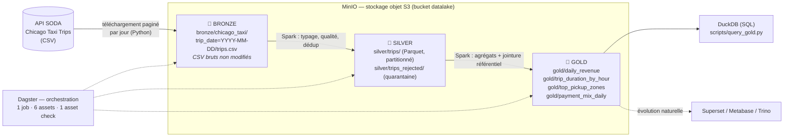

# 🚕 Mobility Datalake — Pipeline Chicago Taxi Trips

Pipeline de données **de bout en bout** en architecture **médaillon** (Bronze → Silver → Gold) :
ingestion d'une API publique, nettoyage et contrôle qualité avec **PySpark**, agrégats prêts pour la BI,
le tout **orchestré par Dagster**, stocké sur du **stockage objet S3**, et lancé en local avec **Docker Compose**.

> Test technique « équipe data » — ce document décrit ce qui a été construit, comment le lancer,
> pourquoi chaque choix a été fait, ce qui a été testé sur de vraies données, et ce que j'améliorerais avec plus de temps.

---

## Sommaire
1. [Résumé](#1-résumé)
2. [Démarrage rapide](#2-démarrage-rapide)
3. [Architecture](#3-architecture)
4. [Le jeu de données & la reproductibilité](#4-le-jeu-de-données--la-reproductibilité)
5. [Détail des couches](#5-détail-des-couches)
6. [Orchestration (Dagster)](#6-orchestration-dagster)
7. [Qualité des données](#7-qualité-des-données)
8. [Couche d'exposition (SQL)](#8-couche-dexposition-sql)
9. [Tests](#9-tests)
10. [Résultats des runs de référence](#10-résultats-des-runs-de-référence)
11. [Choix techniques & arbitrages](#11-choix-techniques--arbitrages)
12. [Difficultés rencontrées](#12-difficultés-rencontrées)
13. [Limites connues](#13-limites-connues)
14. [Avec plus de temps](#14-avec-plus-de-temps)
15. [Structure du repo](#15-structure-du-repo)
16. [Scénario de test réel (API SODA) — preuves par couche](#16-scénario-de-test-réel-api-soda--preuves-par-couche)

---

## 1. Résumé

| Besoin du sujet | Réalisation |
|---|---|
| Ingérer des données brutes | Téléchargement paginé de l'API SODA (Chicago Taxi Trips), CSV déposés **tels quels** dans la couche *bronze*, partitionnés par jour, ingestion **idempotente** |
| Nettoyer et transformer | Spark : typage, normalisation, 7 règles de qualité, déduplication, **quarantaine** des lignes rejetées → couche *silver* (Parquet) |
| Exposer des agrégats BI | 4 tables *gold* : revenus par jour, durée des trajets, top zones de prise en charge, mix de paiement + requêtes SQL (DuckDB) |
| Orchestration | **Dagster** : 6 assets, 1 job, 1 asset check bloquant, lineage et métadonnées visibles dans l'UI |
| Processing | **PySpark 3.5** |
| Tout en local, une commande | **Docker Compose** : `docker compose up -d --build` puis lancement du job |

---

## 2. Démarrage rapide

### Prérequis
- **Docker Desktop** (Windows/macOS) ou Docker Engine + plugin Compose v2 (Linux), en mode **conteneurs Linux**
- ~6 Go de RAM alloués à Docker, ~4 Go de disque
- Accès Internet (build de l'image + API SODA)
- Ports libres : `3000` (Dagster), `9000`/`9001` (MinIO) — modifiables, voir ci-dessous

### Lancement pas à pas

```bash
# 1. Cloner et se placer dans le repo
git clone <url-du-repo> && cd mobility-datalake

# 2. (optionnel) personnaliser la configuration
cp .env.example .env

# 3. Build + démarrage de MinIO et Dagster (1er build : 5 à 10 min)
docker compose up -d --build
docker compose ps                  # les 2 services doivent être "Up"

# 4. Lancer le pipeline complet bronze -> silver -> gold
docker compose exec dagster dagster job execute -m pipeline.definitions -j medallion_pipeline
#    ou depuis l'UI : http://localhost:3000 -> Jobs -> medallion_pipeline -> Launch run

# 5. Interroger les tables Gold en SQL
docker compose exec dagster python scripts/query_gold.py
```

Des raccourcis `make up | run | sql | test | down | clean` sont fournis (Linux/macOS/WSL).

| Service | URL | Identifiants |
|---|---|---|
| Interface Dagster | http://localhost:3000 | – |
| Console MinIO (explorer le datalake) | http://localhost:9001 | `minioadmin` / `minioadmin` |

### Port déjà utilisé ?
Si `3000` est occupé (serveur de dev, base de données…), le démarrage échoue avec *« ports are not available »*.
Il suffit de changer le port exposé dans `.env` :
```
DAGSTER_PORT=3001
```
puis `docker compose up -d`. Même principe avec `MINIO_API_PORT` et `MINIO_CONSOLE_PORT`.

### Mode démo hors-ligne
Un générateur de données factices (même schéma que la source, **anomalies injectées volontairement** pour exercer
les règles de qualité) permet de tout tester sans l'API :
```bash
echo "SOURCE_MODE=synthetic" > .env
docker compose up -d
docker compose exec dagster dagster job execute -m pipeline.definitions -j medallion_pipeline
```

### Arrêt / reset
```bash
docker compose down        # arrêt (données conservées dans les volumes)
docker compose down -v     # arrêt + suppression de toutes les données
```

> Les captures d'écran d'un **run réel sur l'API SODA** (une par couche et par asset) sont regroupées dans la [section 16](#16-scénario-de-test-réel-api-soda--preuves-par-couche).

---

## 3. Architecture



### Services Docker Compose

| Service | Rôle |
|---|---|
| `minio` | Stockage objet compatible S3 — socle du datalake |
| `dagster` | Orchestrateur (UI + daemon via `dagster dev`) **et** exécution Spark en mode local dans le même conteneur (Java 17, PySpark 3.5, connecteur S3A) |

### Flux de données d'un run
1. `bronze_trips` (Python) télécharge chaque jour de la période via l'API SODA et dépose le CSV dans MinIO.
2. `silver_trips` (Spark) lit tout le bronze, type les colonnes, applique les règles qualité, déduplique, écrit le Parquet valide et la quarantaine, puis évalue l'asset check.
3. 4 assets `gold_*` (Spark) lisent le silver et écrivent les tables analytiques.
4. Les tables gold sont interrogeables en SQL.

---

## 4. Le jeu de données & la reproductibilité

- **Source** : [Chicago Taxi Trips 2013-2023](https://data.cityofchicago.org/Transportation/Taxi-Trips-2013-2023-/wrvz-psew) (identifiant `wrvz-psew`), via l'API SODA au format CSV.
- **Période par défaut** : du **2023-01-01 (inclus) au 2023-01-15 (exclu)**, soit 14 jours — un volume léger pour des runs rapides.
- **Méthode de téléchargement** (`pipeline/ingestion/soda.py`) :
  - une requête paginée **par jour**, filtrée avec `$where` sur `trip_start_timestamp` ;
  - `$order=trip_id` pour une pagination **stable** ; `$limit` / `$offset` pour paginer ;
  - **retries avec backoff** exponentiel (429, 5xx) ;
  - le fichier du jour est écrit en un seul CSV avec un unique en-tête.
- **Changer la période** (exemple : premier trimestre 2023) :
  ```bash
  # dans .env
  START_DATE=2023-01-01
  END_DATE=2023-04-01
  ```
  La période et le plafond de lignes (`max_rows_per_day`) sont aussi modifiables **au lancement du run dans l'UI Dagster** (config de l'asset `bronze_trips`).
- **Télécharger un échantillon sans Docker** (même layout que le bronze) :
  ```bash
  pip install requests
  python scripts/download_sample.py --start 2023-01-01 --end 2023-04-01 --out data/raw
  ```
- **Quotas** : sans token, l'API SODA est limitée en débit. Un *app token* gratuit (`SODA_APP_TOKEN` dans `.env`) accélère nettement les gros téléchargements.

---

## 5. Détail des couches

### 🥉 Bronze — données brutes
- **Chemin** : `s3://datalake/bronze/chicago_taxi/trip_date=YYYY-MM-DD/trips.csv`
- **Principe** : aucune transformation. On conserve la donnée telle que reçue, ce qui permet de **rejouer** tout le Silver en cas de changement de règle.
- **Idempotence** : si le fichier d'un jour existe déjà, il est ignoré (`[skip] … déjà présent`). L'option `force=true` force la réingestion.
- **Métadonnées Dagster** : nombre de jours ingérés/ignorés/vides, lignes, Mo, période.

### 🥈 Silver — données propres
- **Chemins** :
  - `s3://datalake/silver/trips/trip_date=…/` — Parquet, partitionné par jour
  - `s3://datalake/silver/trips_rejected/` — quarantaine (lignes rejetées + `reject_reason`)
- **Transformations** (`pipeline/transformations/silver.py`) :
  - parsing des timestamps, typage numérique (`int`, `double`) ;
  - trim des chaînes, chaînes vides → `NULL` ;
  - normalisation : `payment_type` en casse titre (valeur par défaut `Unknown`), `company` (défaut `Unknown`) ;
  - renommage : `pickup_centroid_latitude` → `pickup_latitude`, etc. ;
  - colonnes dérivées : `trip_date`, `trip_hour`, `duration_min` ;
  - **déduplication** sur `trip_id`.
- **Schéma principal** :

| Colonne | Type | Description |
|---|---|---|
| `trip_id` | string | identifiant unique du trajet |
| `taxi_id` | string | identifiant du taxi |
| `trip_start_ts` / `trip_end_ts` | timestamp | début / fin |
| `trip_seconds` | int | durée en secondes |
| `trip_miles` | double | distance |
| `pickup_community_area` / `dropoff_community_area` | int | zones de prise en charge / dépose (1–77) |
| `fare`, `tips`, `tolls`, `extras`, `trip_total` | double | montants |
| `payment_type`, `company` | string | normalisés |
| `pickup_latitude/longitude`, `dropoff_latitude/longitude` | double | centroïdes |
| `trip_date` | date | **partition** |
| `trip_hour` | int | heure de départ (0–23) |
| `duration_min` | double | durée en minutes |

### 🥇 Gold — tables analytiques

| Table | Grain | Contenu |
|---|---|---|
| `gold/daily_revenue` | 1 ligne / jour | `trips`, `total_revenue`, `total_fare`, `total_tips`, `total_tolls`, `total_extras`, `avg_trip_total`, `tip_rate` |
| `gold/trip_duration_by_hour` | 1 ligne / jour × heure | `trips`, `avg_duration_min`, `median_duration_min`, `avg_distance_miles` |
| `gold/top_pickup_zones` | 1 ligne / zone (top 20) | `rank`, `pickup_community_area`, `community_area_name`, `trips`, `total_revenue`, `avg_trip_total`, `avg_duration_min` |
| `gold/payment_mix_daily` | 1 ligne / jour × moyen de paiement | `trips`, `total_revenue`, `trips_share` |

`top_pickup_zones` illustre la **jointure** : les agrégats sont joints (broadcast join) au référentiel
`pipeline/seeds/community_areas.csv` (les 77 *community areas* de Chicago) pour afficher le nom des zones.

---

## 6. Orchestration (Dagster)

- **6 software-defined assets** : `bronze_trips` → `silver_trips` → `gold_daily_revenue`, `gold_trip_duration_by_hour`, `gold_top_pickup_zones`, `gold_payment_mix_daily`.
- **1 job** `medallion_pipeline` qui matérialise l'ensemble.
- **Ressources** : `S3Resource` (boto3, MinIO) et `SparkResource` (SparkSession configurée pour S3A).
- **Executor in-process** : les assets s'exécutent séquentiellement dans un seul process, donc **une seule JVM Spark par run**. L'executor multiprocess par défaut lancerait plusieurs JVM en parallèle et saturerait la mémoire.
- **Métadonnées** visibles dans l'UI : volumes ingérés, lignes valides/rejetées, motifs de rejet, ratio de rejet.
- **Configuration au lancement** : période, mode source, plafond de lignes, `force`.

Les captures de chaque asset dans l'interface Dagster, après un run réel, sont en [section 16](#16-scénario-de-test-réel-api-soda--preuves-par-couche).

---

## 7. Qualité des données

Les règles sont appliquées dans l'ordre ; **le premier motif qui correspond est retenu** (`reject_reason`).

| # | Motif | Condition de rejet |
|---|---|---|
| 1 | `missing_trip_id` | `trip_id` absent |
| 2 | `invalid_start_timestamp` | début non parsable |
| 3 | `invalid_end_timestamp` | fin non parsable |
| 4 | `end_before_start` | fin < début |
| 5 | `invalid_trip_seconds` | durée absente, ≤ 0 ou > 24 h |
| 6 | `invalid_trip_miles` | distance < 0 ou > 500 miles |
| 7 | `invalid_amount` | `trip_total` absent, négatif ou > 5 000, ou `fare` négatif |

- **Quarantaine plutôt que suppression** : les lignes rejetées sont conservées dans `silver/trips_rejected/` avec leur motif, pour audit et diagnostic. Le rejet est **mesuré**, pas silencieux.
- **Déduplication** : sur `trip_id`, après les règles de rejet. Les doublons supprimés sont comptés dans les métadonnées.
- **Asset check bloquant** `reject_ratio_below_threshold` : si `(rejetés + doublons) / total` dépasse `REJECT_RATIO_THRESHOLD` (10 % par défaut), le check échoue et **les assets Gold ne sont pas construits**. On ne publie pas d'agrégats BI sur des données dégradées.

---

## 8. Couche d'exposition (SQL)

`scripts/query_gold.py` utilise **DuckDB** pour lire directement les fichiers Parquet du Gold sur MinIO (via `httpfs`) et exécute quatre requêtes métier :

```bash
docker compose exec dagster python scripts/query_gold.py
```

1. Revenus par jour
2. Durée moyenne des trajets par jour
3. Top 10 des zones de prise en charge
4. Mix de paiement sur la période

Les tables sont aussi consultables en SQL ad hoc : DuckDB expose les vues `daily_revenue`, `trip_duration_by_hour`,
`top_pickup_zones` et `payment_mix_daily`.

---

## 9. Tests

```bash
docker compose exec dagster pytest -q       # ou : make test
```

| Fichier | Ce qui est testé |
|---|---|
| `tests/test_ingestion.py` | pagination SODA (HTTP mocké) : en-tête unique, dernière page, multiple exact de la taille de page, plafond `max_rows`, jour vide ; générateur synthétique : schéma, anomalies, déterminisme |
| `tests/test_transformations.py` | règles de rejet et motifs, déduplication, normalisation, agrégats gold (revenus, top zones avec jointure) — sur un Spark local en mémoire |

La logique Spark est isolée dans `pipeline/transformations/` sous forme de fonctions `DataFrame → DataFrame`,
indépendantes de Dagster et de S3, ce qui les rend testables unitairement.

---

## 10. Résultats des runs de référence

Deux runs complets ont été exécutés de bout en bout dans Docker : un sur **données synthétiques** (anomalies injectées
volontairement, pour prouver que chaque règle détecte ce qu'elle doit détecter) et un sur **données réelles** de l'API SODA.

### Run synthétique (14 jours × 2 020 lignes)

| Étape | Résultat |
|---|---|
| Bronze | 14 jours ingérés, 2 020 lignes par jour (≈ 0,5 Mo chacun) — **1,6 s** |
| Silver | **28 280** lignes en entrée → **26 921** valides, **1 101** rejetées, **258** doublons supprimés — **36 s** |
| Taux de rejet (rejetés + doublons) | ≈ **4,8 %** → check qualité **réussi** (seuil 10 %) |
| Gold | 4 tables construites en ≈ 3 s chacune |
| **Run complet** | **≈ 51 s**, `RUN_SUCCESS` |

Bilan cohérent : 26 921 + 258 + 1 101 = 28 280. Ici les anomalies sont **créées par le générateur** : 20 doublons,
20 montants négatifs, 20 fins avant début, 20 `trip_id` vides et 20 durées nulles par jour (28 280 = 14 × (2 000 + 20 doublons)).

### Run réel — API SODA (3 jours, plafonné à 5 000 lignes/jour)

| Étape | Résultat |
|---|---|
| Bronze | 3 jours × 5 000 lignes = **15 000** lignes (≈ 2,2 Mo par jour) — **18 s** |
| Silver | **15 000** en entrée → **14 677** valides, **323** rejetées, **0** doublon — **2 min 22 s** |
| Taux de rejet | ≈ **2,2 %** → check qualité **réussi** (seuil 10 %) |
| Gold | 4 tables construites (de 5 s à 27 s chacune) |
| **Run complet** | **≈ 3 min 35 s**, `RUN_SUCCESS` |

Bilan cohérent : 14 677 + 323 = 15 000. Les 323 rejets sont de **vraies anomalies de la source** ; leur répartition par motif
est dans les métadonnées de l'asset `silver_trips` (`reject_reasons`). Le détail et les preuves visuelles sont en [section 16](#16-scénario-de-test-réel-api-soda--preuves-par-couche).

---

## 11. Choix techniques & arbitrages

| Choix | Raison | Compromis |
|---|---|---|
| **Dagster** (vs Airflow) | Modèle *asset-centric* qui épouse le médaillon : lineage, métadonnées et asset checks natifs. Un seul process (`dagster dev`) pour le local, sans scheduler/worker/base de métadonnées supplémentaires à orchestrer dans Compose | Moins répandu qu'Airflow ; en production on passerait à PostgreSQL + services séparés |
| **Spark en mode `local[*]`** dans le conteneur Dagster | Respecte l'exigence PySpark en gardant un `docker compose up` simple et léger. Le code ne dépend pas du mode : passer sur un cluster = changer `master` | Pas de vraie distribution sur la machine locale |
| **Executor in-process** | Une seule JVM Spark par run, mémoire maîtrisée | Pas de parallélisme entre assets |
| **MinIO + connecteur S3A** | Vrai stockage objet S3 : le même code tourne sur AWS/GCS/Scaleway en changeant l'endpoint | Dépendance aux jars `hadoop-aws` (embarqués dans l'image) |
| **Parquet** (pas Delta/Iceberg) | Zéro dépendance supplémentaire, très lisible. Idempotence via `overwrite` + `partitionOverwriteMode=dynamic` | Pas de MERGE ni de time travel |
| **Bronze = CSV non modifiés** | Fidélité à la source, rejouabilité complète | Moins compact que du Parquet |
| **Quarantaine + asset check bloquant** | Auditabilité de la qualité ; protection du Gold | Seuil global unique (pas de seuil par règle) |
| **Logique Spark séparée de Dagster** | Fonctions pures testables | Un peu plus de fichiers |
| **Ingestion en Python, pas en Spark** | Paginer une API HTTP n'a rien de distribué ; Spark intervient là où il apporte de la valeur | – |
| **DuckDB pour l'exposition** | Couche SQL immédiate sur le Parquet S3, sans service supplémentaire | Pas une vraie plateforme BI |
| **Générateur synthétique** | Démo hors-ligne, tests, et exercice des règles qualité de façon déterministe | Données non réelles |

---

## 12. Difficultés rencontrées

- **Retrait des images officielles MinIO** : l'image `minio/minio` n'est plus disponible sur Docker Hub, et quay.io refuse
  désormais les pulls anonymes. Le `docker-compose.yml` utilise un **miroir communautaire non modifié**
  (`scnd/minio-mirror`), surchargeable via `MINIO_IMAGE`. Grâce à l'usage de l'API S3 standard (S3A / boto3),
  le code est indépendant de ce choix : en production on utiliserait un S3 managé (AWS, GCS, Scaleway) ou un autre
  serveur S3 maintenu (RustFS, SeaweedFS, Garage), en changeant uniquement l'endpoint et les identifiants.
- **Conflits de ports locaux** : les ports hôtes sont paramétrables via `.env` (`DAGSTER_PORT`, etc.).
- **Plusieurs JVM Spark en parallèle** : l'executor multiprocess par défaut de Dagster lançait une JVM par asset gold ;
  le job utilise l'executor in-process pour partager une seule session.
- **Construction d'expressions Spark** : `F.col()` nécessite une SparkSession active ; les règles qualité sont donc
  construites dans des fonctions (et non au niveau du module).

---

## 13. Limites connues

- **Spark local** : adapté à quelques centaines de milliers / quelques millions de lignes ; pas de scalabilité horizontale en l'état.
- **Retraitement complet du Silver** à chaque run (pas d'incrémental) : acceptable pour ce volume, à remplacer par des partitions Dagster + backfills.
- **Test réel sur un échantillon plafonné** (5 000 lignes/jour sur 3 jours) : le pipeline n'a pas été éprouvé sur une journée complète ni sur un trimestre.
- **Miroir MinIO communautaire** : acceptable pour un environnement local, pas pour la production.
- **Credentials en clair** dans `docker-compose.yml` (valeurs de dev par défaut).
- **Ratio de rejet global** : un seul seuil ; pas de seuil par règle ni de détection de dérive.
- **Pas de contrôle de fraîcheur** de la source ni d'alerting.

---

## 14. Avec plus de temps

- **Format de table transactionnel** (Delta Lake / Iceberg) : MERGE/upserts, time travel, évolution de schéma.
- **Partitions Dagster quotidiennes** + backfills + schedule, pour un traitement **incrémental**.
- **Spark sur cluster** (master/worker dans Compose ou Kubernetes) et committer S3A optimisé.
- **Qualité avancée** : Great Expectations / Soda, seuils par règle, contrôles de complétude et de fraîcheur, alerting.
- **BI** : Superset/Metabase ou Trino branché sur le Gold ; exposition d'une API de KPIs.
- **CI/CD** : GitHub Actions (lint `ruff`, tests, build de l'image).
- **Sécurité & prod** : secrets via un gestionnaire dédié, utilisateurs S3 à moindre privilège, PostgreSQL pour la metadata Dagster.
- **Enrichissements** : jointures géographiques (census tracts), météo, calendrier des jours fériés.

---

## 15. Structure du repo

```
.
├── docker-compose.yml        # minio + dagster
├── Dockerfile                # Python 3.11 + Java 17 + PySpark + jars S3A + Dagster
├── Makefile                  # raccourcis (up, run, sql, test, down, clean)
├── requirements.txt
├── dagster.yaml              # config de l'instance Dagster
├── workspace.yaml            # point d'entrée du code Dagster
├── .env.example              # variables de configuration
├── pipeline/
│   ├── definitions.py        # Definitions Dagster : assets, job, ressources
│   ├── resources.py          # S3Resource (boto3) · SparkResource (SparkSession + S3A)
│   ├── config.py             # chemins du datalake
│   ├── ingestion/
│   │   ├── soda.py           # téléchargement paginé de l'API SODA
│   │   └── synthetic.py      # générateur de données factices
│   ├── assets/               # bronze.py · silver.py · gold.py   (orchestration)
│   ├── transformations/      # silver.py · gold.py               (logique PySpark pure)
│   └── seeds/community_areas.csv   # référentiel des 77 zones de Chicago
├── scripts/
│   ├── download_sample.py    # téléchargement local d'un échantillon
│   └── query_gold.py         # exposition SQL (DuckDB)
├── tests/                    # tests unitaires (pytest)
└── docs/screenshots/            # captures du run réel (section 16)
```

---

## 16. Scénario de test réel (API SODA) — preuves par couche

Cette section documente un run exécuté sur les **vraies données** de l'API SODA (`SOURCE_MODE=soda`), par opposition au run
synthétique de la section 10. Chaque couche est prouvée de deux façons : le **fichier réellement présent dans le stockage objet**
(console MinIO) et l'**asset correspondant dans Dagster**.

### 16.1 Configuration du scénario

Fichier `.env` utilisé :
```
SOURCE_MODE=soda
START_DATE=2023-01-01
END_DATE=2023-01-04
MAX_ROWS_PER_DAY=5000
DAGSTER_PORT=3001
```
- **Période** : 3 jours (2023-01-01, 2023-01-02, 2023-01-03 ; `END_DATE` est exclu).
- **Plafond de 5 000 lignes par jour** : pour tester vite et rester dans les quotas de l'API publique.

Commandes exécutées :
```bash
docker compose down -v          # repartir de zéro : pas de données synthétiques résiduelles dans le bronze
docker compose up -d
docker compose exec dagster dagster job execute -m pipeline.definitions -j medallion_pipeline
```

### 16.2 Résultat du run

| Asset | Résultat observé | Durée |
|---|---|---|
| `bronze_trips` | 3 fichiers de 5 000 lignes (≈ 2,2 Mo chacun) → **15 000 lignes** | 18,25 s |
| `silver_trips` | 15 000 en entrée → **14 677 valides**, **323 rejetées**, **0 doublon** ; ratio de rejet ≈ 2,2 % < 10 % | 2 min 22 s |
| `gold_daily_revenue` | table construite | 8,48 s |
| `gold_payment_mix_daily` | table construite | 5,1 s |
| `gold_top_pickup_zones` | table construite (jointure + fonction fenêtre) | 27,31 s |
| `gold_trip_duration_by_hour` | table construite | 12,07 s |
| **Run complet** | `RUN_SUCCESS` | **3 min 35 s** |

Le check bloquant `reject_ratio_below_threshold` est passé : les quatre assets gold n'ont pu s'exécuter qu'à cette condition.
Bilan : 14 677 + 323 = 15 000.

### 16.3 Preuves — couche Bronze

Fichiers CSV bruts, partitionnés par jour, dans le bucket `datalake` (console MinIO) :


L'asset `bronze_trips` dans Dagster :


### 16.4 Preuves — couche Silver

Fichiers Parquet de la couche silver dans MinIO :


L'asset `silver_trips` dans Dagster :


### 16.5 Preuves — couche Gold

Fichiers Parquet de la couche gold dans MinIO :


Les quatre assets gold dans Dagster :

**`gold_daily_revenue`** — revenus par jour


**`gold_payment_mix_daily`** — répartition des moyens de paiement


**`gold_top_pickup_zones`** — top zones de prise en charge


**`gold_trip_duration_by_hour`** — durée des trajets par jour et par heure


### 16.6 Synthétique vs réel

| | Run synthétique | Run réel (SODA) |
|---|---|---|
| Lignes en entrée | 28 280 | 15 000 |
| Valides | 26 921 | 14 677 |
| Rejetées | 1 101 | 323 |
| Doublons supprimés | 258 | 0 |
| Taux d'anomalies | ≈ 4,8 % | ≈ 2,2 % |
| Origine des anomalies | injectées par le générateur | présentes dans la source |

### 16.7 Lecture critique du test

- **`doublons=0` sur la donnée réelle** : `trip_id` est unique à la source sur cet échantillon. La déduplication reste utile : elle a supprimé 258 doublons sur le run synthétique et elle est couverte par des tests unitaires.
- **Les 323 rejets sont de vraies anomalies de la source.** Leur répartition par motif (`reject_reasons`) est lisible dans les métadonnées de l'asset `silver_trips` ; les lignes elles-mêmes sont conservées dans `silver/trips_rejected/`.
- **C'est un échantillon**, pas des journées complètes : le plafond de 5 000 lignes par jour, avec un tri sur `trip_id` (un hash, donc un échantillon à peu près aléatoire), signifie que les montants du gold ne sont **pas** les totaux réels de Chicago. Sans plafond (`MAX_ROWS_PER_DAY=0`), le pipeline traite la journée complète.
- **Les durées sont indicatives** : mesurées sur une machine locale (Docker Desktop), elles ne constituent pas un benchmark. Le Silver a notamment été plus lent sur le réel (2 min 22 s) que sur le synthétique (36 s) malgré moins de lignes, ce que ces logs ne permettent pas d'expliquer avec certitude.
